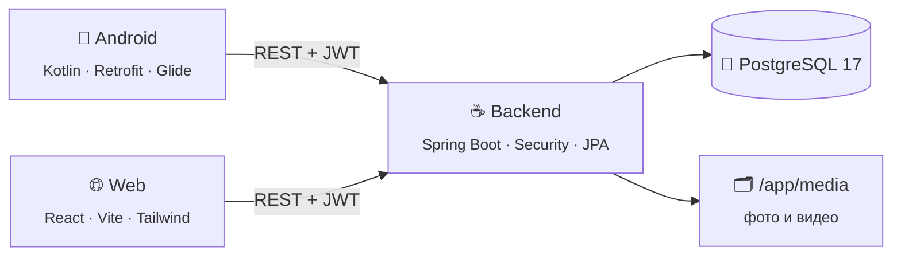

<div align="center">

# 🥊 TKO Fitness

**Тренировки, программы, питание и прогресс — в одном приложении**

Android-клиент · Веб-клиент · REST API на Spring Boot

<br>


<br>


<br>

[Возможности](#-возможности) ·
[Архитектура](#-архитектура) ·
[Быстрый старт](#-быстрый-старт) ·
[API](#-api) ·
[Структура](#-структура-репозитория) ·

</div>

---

## ✨ Возможности

<table>
<tr>
<td width="50%" valign="top">

### 🏋️ Тренировки
- Каталог упражнений с фото и видео
- **Фильтры** по группам мышц, сложности, инвентарю, рейтингу и популярности
- **Сортировка** по рейтингу, популярности, названию и новизне
- Поиск по названию, бесконечная прокрутка
- Конструктор тренировок: подходы, повторы, отдых
- Режим выполнения тренировки с видео (ExoPlayer)
- Схема задействованных мышц на SVG-модели тела (мужская/женская)

</td>
<td width="50%" valign="top">

### 📅 Программы и план
- Готовые тренировочные программы
- Привязка тренировок к программе
- Текущая программа пользователя
- Календарь запланированных тренировок
- Лайки тренировок, программ и упражнений

</td>
</tr>
<tr>
<td width="50%" valign="top">

### 🥗 Питание (Coming soon)
- Трекер калорий по дням
- Приёмы пищи: завтрак, обед, ужин, перекус
- Поиск продуктов и добавление своих
- Расчёт дневной нормы калорий

</td>
<td width="50%" valign="top">

### 👤 Профиль
- Регистрация и вход по **JWT**
- Редактирование профиля
- Трекер веса с графиком (MPAndroidChart)
- Токен хранится в EncryptedSharedPreferences

</td>
</tr>
</table>

---

## 🏗 Архитектура



| Слой | Стек |
|---|---|
| **Backend** | Java 17, Spring Boot 3.3 (Web, Data JPA, Security, Validation, Actuator), MapStruct, Lombok, jjwt, Apache Batik |
| **БД** | PostgreSQL 17, схема в `backend/init/schema.sql` |
| **Android** | Kotlin, minSdk 34, ViewBinding, Retrofit + Gson, OkHttp, Glide, Media3 ExoPlayer, AndroidSVG, MPAndroidChart |
| **Web** | React 19, React Router 7, Axios, Tailwind CSS 4, Vite 6 |
| **Инфраструктура** | Docker, Docker Compose |

---

## 🚀 Быстрый старт

### Что нужно

| Инструмент | Версия |
|---|---|
| Docker + Docker Compose | любая актуальная |
| JDK | 17 |
| Maven | 3.8+ |
| Android Studio | Ladybug или новее (для клиента) |
| Node.js | 18+ (для веба) |

### 1. Backend + база данных

> [!IMPORTANT]
> `Dockerfile` **копирует уже собранный jar** из `target/`. Перед `docker compose build` jar нужно пересобрать, иначе в контейнер попадёт старая версия кода.

<details open>
<summary><b>🪟 Windows (PowerShell)</b></summary>

```powershell
cd backend
mvn clean package -DskipTests
docker compose build backend
docker compose up -d
```

</details>

<details>
<summary><b>🐧 Linux / 🍎 macOS</b></summary>

```bash
cd backend
mvn clean package -DskipTests && docker compose up -d --build
```

</details>

Поднимутся два контейнера:

| Сервис | Адрес | Описание |
|---|---|---|
| `backend` | `http://localhost:8080/api` | REST API |
| `db` | `localhost:5433` | PostgreSQL (`tko_database`) |

При **первом** запуске PostgreSQL выполнит `init/schema.sql` и создаст таблицы. Дальше схему обновляет Hibernate (`ddl-auto=update`).

Проверить, что всё работает:

```bash
curl -X POST http://localhost:8080/api/register \
     -H "Content-Type: application/json" \
     -d '{"name":"Test","login":"test","password":"test123","birthDay":"2000-01-01","weight":70,"height":175,"gender":"MALE"}'
```

> На Windows используйте `curl.exe`: просто `curl` в PowerShell — это алиас другой команды.

<details>
<summary><b>📼 Медиафайлы упражнений</b></summary>

Картинки и видео отдаются с диска контейнера:

```
/app/media/image/<photo_url>
/app/media/video/<video_url>
```

Чтобы они сохранялись между перезапусками, примонтируйте папку в `docker-compose.yaml`:

```yaml
  backend:
    volumes:
      - ./media:/app/media
```

</details>

<details>
<summary><b>💻 Запуск без Docker (из IDE)</b></summary>

1. Поднимите только базу: `docker compose up -d db`
2. Запустите `tko.Application` из IntelliJ IDEA.
3. `application.properties` уже смотрит на `localhost:5433`.

</details>

### 2. Android-приложение

1. Откройте папку `android/` в Android Studio и дождитесь Gradle Sync.
2. Запустите на эмуляторе с **Android 14+** (API 34).

Адрес сервера задаётся в `ApiService.kt`:

```kotlin
internal const val BASE_URL = "http://10.0.2.2:8080/"
```

| Где запущено | `BASE_URL` |
|---|---|
| Эмулятор, бэкенд на этом же ПК | `http://10.0.2.2:8080/` |
| Реальный телефон в той же Wi-Fi сети | `http://<IP-компьютера>:8080/` |
| Удалённый сервер | `http://<IP-сервера>:8080/` |

### 3. Веб-клиент

```bash
cd web
npm install
npm run dev
```

Откроется на `http://localhost:5173`. Адрес API сейчас прописан прямо в компонентах (`LoginForm.jsx`, `Catalog.jsx` и др.) — при смене сервера замените его там.

---

## 📡 API

Все эндпоинты начинаются с **`/api`**. Открыты без токена только `/register` и `/login`, остальные требуют заголовок:

```http
Authorization: Bearer <jwt>
```

<details>
<summary><b>🔐 Авторизация и пользователи</b></summary>

| Метод | Путь | Описание |
|---|---|---|
| `POST` | `/register` | Регистрация |
| `POST` | `/login` | Вход, возвращает `token`, `userId`, `name` |
| `GET` | `/user/{id}` | Профиль пользователя |
| `POST` · `GET` · `PUT` · `DELETE` | `/weight[/{id}]` | Записи веса |
| `GET` | `/weight/list-by-dates/{id}` | Вес за период |

</details>

<details open>
<summary><b>🏋️ Упражнения и каталог</b></summary>

| Метод | Путь | Описание |
|---|---|---|
| `GET` | `/exercise/catalog` | **Каталог с фильтрами и сортировкой** |
| `GET` | `/exercise/filters` | Значения для панели фильтров |
| `GET` | `/exercise/page` | Список упражнений постранично |
| `GET` | `/exercise/{id}` | Упражнение целиком |
| `POST` · `PUT` · `DELETE` | `/exercise[/{id}]` | Управление упражнениями (`ROLE_ADMIN` на создание) |
| `GET` · `PUT` | `/exercise/meta-data/{id}` | Ссылки на медиа |
| `GET` | `/exercise/image/{id}` | Картинка (JPEG) |
| `GET` | `/exercise/video/{id}` | Видео (MP4) |
| `GET` | `/exercise/svg/{id}?gender=MALE` | SVG-модель тела с подсвеченными мышцами |
| `POST` · `DELETE` | `/like-exercise` | Лайк упражнения |

**Параметры `/exercise/catalog`** — все необязательные:

| Параметр | Пример | Описание |
|---|---|---|
| `muscles` | `muscles=BICEPS&muscles=TRICEPS_BRACHII` | Группы мышц |
| `matchAllMuscles` | `true` | Все выбранные мышцы сразу (по умолчанию — любая) |
| `difficulties` | `EASY`, `MEDIUM`, `HARD` | Сложность |
| `types` | `STRENGTH`, `CARDIO`, `FLEXIBILITY`, `BALANCE`, `ENDURANCE` | Тип упражнения |
| `requiresEquipment` | `false` | Нужен ли инвентарь |
| `minLikes` | `10` | Минимальный рейтинг |
| `minUsage` | `5` | Минимальная популярность (сколько раз добавлено в тренировки) |
| `name` | `жим` | Поиск по названию |
| `onlyLiked` | `true` | Только понравившиеся |
| `sort` | `RATING` · `POPULARITY` · `NAME` · `NEWEST` | Сортировка |
| `direction` | `ASC` · `DESC` | Направление |
| `page`, `size` | `0`, `20` | Пагинация (`size` ≤ 100) |

```http
GET /api/exercise/catalog?muscles=PECTORALIS_MAJOR&difficulties=EASY&sort=POPULARITY&page=0&size=20
```

</details>

<details>
<summary><b>📋 Тренировки и программы</b></summary>

| Метод | Путь | Описание |
|---|---|---|
| `GET` | `/workout/page` | Список тренировок |
| `GET` · `POST` · `PUT` · `DELETE` | `/workout[/{id}]` | CRUD тренировок |
| `GET` | `/workout-exercise/workout/{id}` | Упражнения тренировки по порядку |
| `POST` · `PUT` · `DELETE` | `/workout-exercise[/{id}]` | Упражнение в тренировке |
| `GET` | `/program/page` | Список программ |
| `GET` · `POST` · `PUT` · `DELETE` | `/program[/{id}]` | CRUD программ |
| `GET` | `/workout-program/workout/{id}` | Тренировки программы |
| `POST` · `GET` | `/current-program[/{id}]` | Текущая программа пользователя |
| `GET` | `/planned-workout/list-by-dates/{userId}?from=&to=` | План на период |
| `POST` · `PUT` · `DELETE` | `/planned-workout[/{id}]` | Запланировать тренировку |
| `POST` · `DELETE` | `/like-workout`, `/like-program` | Лайки |

</details>

<details>
<summary><b>🥗 Питание (Coming soon)</b></summary>

| Метод | Путь | Описание |
|---|---|---|
| `GET` | `/product/search?keyword=` | Поиск продуктов |
| `GET` · `POST` · `PUT` · `DELETE` | `/product[/{id}]` | CRUD продуктов |
| `GET` · `POST` · `PUT` · `DELETE` | `/kcal-tracker[/{id}]` | Дневник калорий |
| `GET` · `POST` · `PUT` · `DELETE` | `/kcal-product[/{id}]` | Продукт в дневнике |

</details>

---

## 📁 Структура репозитория

```
tko_app/
├── backend/                      ☕ Spring Boot API
│   ├── Dockerfile
│   ├── docker-compose.yaml       backend + PostgreSQL
│   ├── init/schema.sql           схема БД (выполняется при первом старте)
│   └── src/main/java/tko/
│       ├── controller/           REST: user · workout · nutrition
│       ├── service/              бизнес-логика
│       ├── database/
│       │   ├── entity/           JPA-сущности
│       │   ├── repository/       Spring Data репозитории
│       │   └── specification/    динамические фильтры каталога
│       ├── model/dto · mapper/   DTO и MapStruct-мапперы
│       ├── security/             JWT-фильтр, CORS, SecurityConfig
│       └── utils/                enum'ы, SVG-модель мышц, расчёт калорий
│
├── android/                      📱 Android-клиент (tk.ssau.fitnesstko)
│   └── app/src/main/
│       ├── java/.../
│       │   ├── catalog/          каталог: фильтры, сортировка, ViewModel
│       │   ├── food/             питание и калории (Coming soon)
│       │   ├── profile/          профиль, вес, расчёт нормы
│       │   ├── user/             вход и регистрация
│       │   ├── model/dto/        DTO для API
│       │   └── ApiService.kt     Retrofit-клиент
│       └── res/                  layout'ы, иконки, темы
│
└── web/                          🌐 React-клиент
    └── src/                      Home · Catalog · Programm · Kcal · Profile
```

---

<div align="center">

Учебный проект · Самарский университет

</div>
